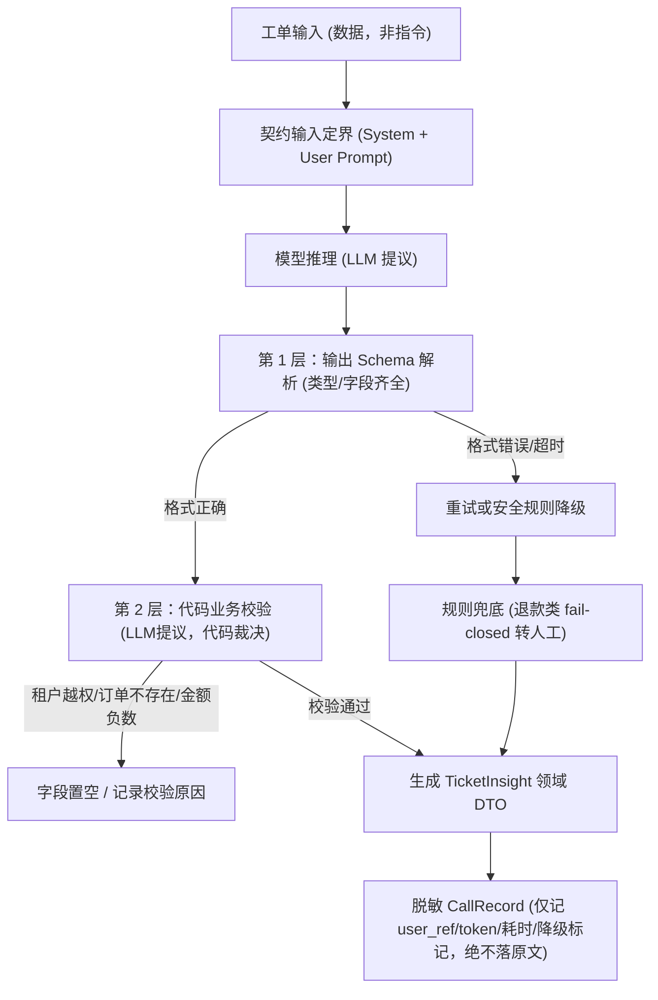

# 1.10 嵌入式 LLM 功能与 Eval Harness

- **能力**：在现有后端服务中嵌入 LLM 洞察能力，构建业务校验、降级熔断与离线评测 Harness
- **目标**：掌握“契约先行、LLM 提议代码裁决、身份不信任模型、fail-closed 退款安全”核心工程设计；掌握基于 golden set 的字段级离线评测体系；对比原生实现与 Pydantic AI（2.31.1）实现
- **时间盒**：6h（2h 概念精读 + 3h 原生与 Pydantic AI 双 Gate 闭卷通关 + 1h 产出 Eval 报告）
- **v3 路径**：L1.10 / 核心（Gate；嵌入式功能）

---

## 1. 为什么“嵌入式功能”是 AI 应用工程师的第一门槛？

很多初学者以为写 AI 应用就是用框架接一个 Agent 聊天框。但在真实的生产系统（SaaS、工单系统、CRM、电商后台）中，**90% 的企业级落地都是把 LLM 作为一个局部智能算子嵌入现有服务**——例如对进线工单自动打标、抽取订单号与退款金额、辅助客服打标签。

这种场景下，大模型不是系统的主宰，而是“不可靠的第三方外部服务”。工程设计的核心不是 Prompt 写得多花哨，而是如何防御模型的不可靠性：



---

## 2. 八大核心工程设计规范

### 规范 1：契约先行，Schema 正确不等于业务有效
LLM 输出的 JSON Schema 校验通过，只能说明“它的数据结构符合要求”，**绝不代表里面的内容是真的**。
- 模型可能编造一个根本不存在的订单号 `ORD-999999`；
- 模型可能在退款金额填入负数 `-100.0`；
- 因此必须做**二阶校验**：第 1 阶校验 JSON Schema，第 2 阶在领域层核验业务逻辑（订单是否存在、金额是否合理）。

### 规范 2：LLM 提议，代码裁决（LLM Proposes, Code Disposes）
LLM 只能提议“我认为这个工单属于退款，优先级是 high”，但它**没有数据库写权限**。写库、触发退款、给用户发通知等写操作，永远留在后端业务 service 层，由确定性代码校验通过后执行。

### 规范 3：身份与租户永不信任模型输出
在多租户系统里，工单属于租户 A。模型输出中绝不能包含 `tenant_id`；即使模型在 JSON 中伪造了 `tenant_id: "tenant_B"`，后端代码也必须**彻底忽略**，所有的租户校验（如订单归属查询）严格从请求上下文（如 FastAPI 依赖注入 `Depends` 或 JWT Claims）中取。

### 规范 4：延迟预算与思考模式控制
- 抽取与分类属于确定性任务，**必须显式关闭思考模式（thinking）**，否则思考 token 会显著拉大 p95 延迟并增加成倍成本。
- 服务必须设定硬超时（如 10s）与最多 1 次格式修复重试，防止拖垮整个 API 网关。

### 规范 5：fail-open 与 fail-closed 的安全决策边界
- **普通工单打标（技术咨询、物流查询）**：模型失败时走关键词规则兜底（fail-open，保证服务可用不中断）；
- **涉及钱与退款的敏感操作**：模型一旦超时、格式解析失败或金额超过阈值（如 ≥500 元），必须**无条件标记 `needs_human=True` 强制转人工审批（fail-closed，防资损）**。宁可多一次人工复核，不可漏过一次错误自动化。

### 规范 6：可观测性与隐私契约
记录日志与调用指标（`CallRecord`）时：
- 必须记录：调用耗时、Prompt 版本、Prompt/Completion Tokens、重试次数、是否发生降级（fallback）、校验失败具体原因；
- **隐私底线**：严禁在可观测指标或日志中记录工单原文；用户标识必须通过不可逆哈希（如 `sha256(user_id)[:12]`）进行脱敏。

### 规范 7：Eval Harness 的四个核心概念
代码改动后如何知道提示词或模型有没有退化？依靠离线评测体系（Eval Harness）。根据 Anthropic 官方文章《Demystifying evals for AI agents》（https://www.anthropic.com/research/demystifying-evals-for-ai-agents，读取于 2026-10-27），现代 AI 评测由四个不可或缺的组件构成：
1. **Task（任务定义）**：工单输入与任务目标；
2. **Trial（运行试验）**：在固定或受控采样下运行模型；由于模型具有随机性，多次 trial 可以测量一致性（Consistency）；
3. **Grader（评分器）**：针对每个字段对比期望值（字段级准确率 Field Accuracy、整题全对通过率 Pass Rate）；
4. **Transcript（运行轨迹与失误归因）**：完整记录错题的输入截断摘要、实际输出与失败字段，便于错误定位。

### 规范 8：Pydantic AI（2.31.1）架构重写与对比
在完成原生 SDK 实现后，我们使用 `pydantic-ai-slim==2.31.1` 重写该功能。两种写法的工程对比如下：

| 对比维度 | 原生 SDK + 手写胶水 | Pydantic AI (2.31.1) |
|---|---|---|
| **代码量** | 约 300 行（需手写 JSON 解析、重试循环、工具消息拼装） | 约 80 行（核心抽取只需一个声明式的 `Agent`） |
| **依赖注入** | 需通过闭包或参数在各层间透传 `FeatureDeps` | 通过 `RunContext[FeatureDeps]` 优雅注入，工具直接读取 `ctx.deps` |
| **错误纠偏** | 需手写将错误追加到 `messages` 并再调用一次模型的循环 | 声明 `@agent.output_validator`，抛出 `ModelRetry` 自动触发纠偏 |
| **测试隔离** | 手写 mock 函数或 client monkeypatch | 官方提供 `FunctionModel` 与 `TestModel`，天然支持全离线确定性单元测试 |

---

## 3. 目录与代码导读

本章提供了一个完整的“现有企业工单服务接入 LLM 功能”的代码骨架：

```text
1.10-embedded-llm-feature/
├── ticket_service/              # 不含 LLM 的现有企业服务骨架
│   ├── domain.py                # 领域模型 (Ticket, TicketInsightDTO)
│   ├── store.py                 # 内存存储（按租户隔离）
│   └── app.py                   # FastAPI REST API (提供 /tickets 与 /insight)
├── embedded_feature.py          # 原生 SDK 参考实现（全离线替身 + --live 真实模型）
├── embedded_feature_pai.py      # Pydantic AI (2.31.1) 参考实现
├── gate/
│   ├── cases.json               # 20 条标准工单 Golden Set 数据集
│   ├── starter.py               # 原生 Gate 学习者闭卷骨架
│   ├── gate_check.py            # 原生 Gate 16 项断言自动化检查
│   ├── starter_pai.py           # Pydantic AI Gate 闭卷骨架
│   └── gate_check_pai.py        # Pydantic AI Gate 6 项断言检查
├── workbook.md                  # 学习练习手册与评测报告记录
└── README.md                    # 本章讲义
```

---

## 4. 自动化 Gate 验证命令

本章为双 Gate 设计：原生工程底座（16 项）+ Pydantic AI 框架底座（6 项）。

```bash
# 1. 运行原生 Gate（检查原生闭卷实现，16 项全通）
python chapters/part1-foundations/1.10-embedded-llm-feature/gate/gate_check.py chapters/part1-foundations/1.10-embedded-llm-feature/embedded_feature.py

# 2. 运行 Pydantic AI Gate（检查 Pydantic AI 实现，6 项全通）
python chapters/part1-foundations/1.10-embedded-llm-feature/gate/gate_check_pai.py chapters/part1-foundations/1.10-embedded-llm-feature/embedded_feature_pai.py

# 3. 运行离线 Golden Set 评测（20 条基准工单集）
python chapters/part1-foundations/1.10-embedded-llm-feature/embedded_feature.py --eval
```

---

## 5. 工程边界与免责声明

1. **规则兜底能力有限**：`rules_fallback` 仅作为防止服务崩溃的熔断层，分类精度无法替代大模型。
2. **20 条 Golden Set 的定位**：20 条用例主要用于 CI 门禁与抗回归验证，生产环境能力评测需要构建百条级真实业务评测集。
3. **真实延迟需实测**：真实环境下模型的 p95 延迟受网络、供应商并发限制影响，必须结合压测确定合理的 timeout。
4. **语言范围**：当前用例与规则针对中文工单设计，多语言场景需扩展提示词定界与多语言分词。
