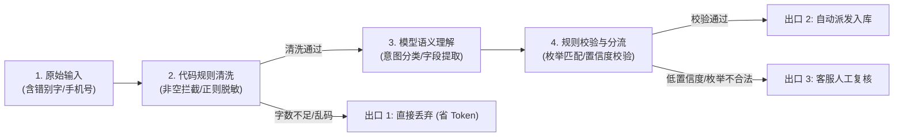

# 1.1 一个需求里，哪些步骤适合交给模型

做用户反馈处理功能时，如果把用户输入的内容直接发给大模型，跑一阵子就会遇到几个问题：请求耗时通常在两三秒以上；调用量上去后账单费用增长很快；返回的 JSON 偶尔缺漏关键字段；甚至把用户写在正文里的手机号直接传给了第三方模型接口。

把一段自然语言处理成系统工单，中间包含几个不同性质的步骤。先看一个具体输入：

> “上周买的耳机左耳一直没声音，申请退款好几天了没人理，订单号 202611028892，麻烦尽快处理，电话 13800138000。”

把这段文字转成业务系统里的结构化数据，可以拆成五步：

1. **步骤 1：输入清洗与隐私脱敏** —— 去除首尾空格，截断超长字符，用正则表达式把手机号中间四位转为星号。
2. **步骤 2：无效输入过滤** —— 过滤两个字以内的无意义字符、纯表情或重复符号。
3. **步骤 3：意图与类别判断** —— 分析这段话的主要诉求，判断属于“硬件故障”、“物流退款”还是“一般咨询”。
4. **步骤 4：关键字段抽取** —— 提取提及的商品模块（左耳）、故障现象（没声音）以及自述订单号（202611028892）。
5. **步骤 5：字段合法性校验与流转分发** —— 检查提取出来的类别和模块是否在系统定义的白名单中。符合条件的写进工单表；不符合条件或置信度较低的转给人工处理。



## 规则、模型与人工的三方分工

这五个步骤分别适合用不同的方式处理：

| 执行手段 | 典型职责 | 耗时 | 单次成本 | 核心特性与工程边界 |
| :--- | :--- | :--- | :--- | :--- |
| **代码规则** | 正则脱敏、非空检查、字符截断、枚举校验、路由落库 | < 1 ms | $0.00 | **确定性 100%**。逻辑固定、执行极快；但只能处理预定义的固定格式，遇到错别字和倒装句无法识别。 |
| **大语言模型** | 开放语义理解、多意图提取、从杂乱文本中抽取半结构化字段 | 200ms ~ 3s | 按 Token 计费 | **擅长非结构化处理**。能读懂错别字和倒装句；但单次调用耗时较长，输出结构有一定概率出现残缺或误判。 |
| **人工确认** | 争议客诉仲裁、低置信度分类、重要退款审核 | 分钟 ~ 小时 | 人力工时成本 | **兜底保障**。处理模糊和有争议的边界情况；但成本最高、速度最慢，无法应对大规模并发。 |

## 完整的处理代码

下面是一段使用 Python 标准库编写的处理程序。不需要配置 API Key，也不需要安装第三方框架，可以直接在本地运行观察整个流转过程：

```python
import re
from typing import Dict, Any

# 1. 系统中允许的业务分类与模块枚举（用于后置校验）
VALID_CATEGORIES = {"硬件故障", "物流退款", "功能建议", "其他咨询"}
VALID_MODULES = {"左耳", "右耳", "充电盒", "耳机线", "通用"}

def sanitize_and_mask_input(raw_text: str) -> str:
    """
    前置规则清洗：去除空白字符并对敏感信息进行脱敏掩码。
    """
    cleaned = raw_text.strip()
    # 匹配中国大陆常见的 11 位手机号并掩码中间 4 位，避免隐私泄露至模型服务商日志
    cleaned = re.sub(r'(1[3-9]\d)\d{4}(\d{4})', r'\1****\2', cleaned)
    return cleaned

def mock_llm_extract(text: str) -> Dict[str, Any]:
    """
    模拟大模型抽取输出。
    在真实调用中，这里发出一趟 HTTP POST 请求，由模型返回 JSON。
    """
    # 静态字典模拟模型对样本的语义解析结果
    return {
        "category": "硬件故障",
        "module": "左耳",
        "complaint": "耳机左耳没声音，申请退款无人响应",
        "order_id": "202611028892",
        "confidence": 0.92
    }

def triage_feedback(raw_text: str) -> Dict[str, Any]:
    """
    完整的工单分流流水线：
    清洗脱敏 -> 垃圾过滤 -> 模型抽取 -> 业务校验 -> 终态分发
    """
    # 步骤一：规则清洗与脱敏（本地代码执行，耗时 < 1ms）
    cleaned_text = sanitize_and_mask_input(raw_text)

    # 步骤二：前置过滤异常文本，避免白白消耗模型 token
    if len(cleaned_text) < 2:
        return {
            "status": "discarded",
            "stage": "pre_filter",
            "reason": "有效字符数不足，视为无效输入",
            "data": None
        }

    # 步骤三：调用模型进行非结构化字段抽取（实际工程中为网络请求）
    extracted = mock_llm_extract(cleaned_text)

    # 步骤四：后置业务规则校验（代码执行，不直接信任外部模型的输出）
    category = extracted.get("category")
    module = extracted.get("module")
    confidence = extracted.get("confidence", 0.0)

    # 校验类别与模块是否在预定义的白名单内
    if category not in VALID_CATEGORIES or module not in VALID_MODULES:
        return {
            "status": "review",
            "stage": "post_validation",
            "reason": f"提取到的枚举值不合法（category={category}, module={module}）",
            "data": extracted
        }

    # 校验置信度阈值：低于 0.85 的模糊判定进入人工复核
    if confidence < 0.85:
        return {
            "status": "review",
            "stage": "confidence_check",
            "reason": f"模型判定置信度较低（{confidence:.2f} < 0.85）",
            "data": extracted
        }

    # 步骤五：校验完全通过，执行自动分流并入库
    return {
        "status": "routed",
        "stage": "complete",
        "target_queue": "hardware_support_queue",
        "data": extracted
    }

if __name__ == "__main__":
    sample_text = "上周买的耳机左耳一直没声音，申请退款好几天了没人理，订单号 202611028892，麻烦尽快处理，电话 13800138000。"
    result = triage_feedback(sample_text)
    print("流水线处理结果：")
    print(result)
```

## 代码的工程考量

### 1. 为什么要这么写？
前置的脱敏和长度检查放在本地用代码运行。手机号脱敏满足合规要求，也能防止敏感信息进入模型服务商的日志；提前拦截两个字以内的无效输入，避免消耗不必要的 Token 费用。后置的枚举校验用来防范模型生成的虚假词汇，确保入库字段与系统字典一致。

### 2. 这个返回值在下游怎么用？
返回值里的 `status` 字段标记了当前数据的去向：
- `routed`：数据合规，直接推入工单消息队列或写入数据库；
- `review`：提取字段异常或置信度偏低，推入客服复核列表，界面上展示 `reason` 辅助人工审核；
- `discarded`：无效输入，仅记入低频调试日志，不建工单。

### 3. 遇到问题时怎么排查？
线上如果出现大量反馈流向人工复核区，可以通过 `stage` 和 `reason` 定位：
- 如果 `stage` 集中在 `post_validation`，说明用户提到的模块名称超出了现有枚举字典，需要扩充字典或调整提示词；
- 如果集中在 `pre_filter`，说明前端没有拦截空输入，需要检查页面端校验逻辑。

## 一页任务说明（Task Spec）

在把任务交给模型之前，先用一页纸明确任务的契约和边界。这是保证系统可测试、可核对的基础：

```json
{
  "task_name": "customer_feedback_triage",
  "version": "1.0.0",
  "input": {
    "type": "string",
    "description": "经过规则前置脱敏后的用户自述文本，最大长度 500 字符"
  },
  "output_schema": {
    "category": "枚举字符串：硬件故障 | 物流退款 | 功能建议 | 其他咨询",
    "module": "枚举字符串：左耳 | 右耳 | 充电盒 | 耳机线 | 通用",
    "complaint": "总结用户核心问题的简要陈述，不超过 50 字",
    "order_id": "自述中提及的订单号字符串，未提及则返回 null",
    "confidence": "浮点数，模型对分类判定的置信度，范围 0.0 ~ 1.0"
  },
  "edge_cases_and_boundaries": {
    "not_handled_by_llm": [
      "包含涉政、攻击性言论等高危内容，直接由安全网关过滤",
      "纯系统日志报错堆栈，转由异常监控系统处理"
    ],
    "fallback_to_human": [
      "置信度低于 0.85 的模糊判定",
      "同时包含多个不同类别诉求的复杂长文本"
    ]
  }
}
```

## 适用范围与边界

这种切分方式适合处理结构相对固定、有明确分类要求的售后和咨询文本。在以下情况下，这种切分方式需要调整：

- 当业务处于快速探索期、分类字典尚未固定时，严格的枚举校验会让过多数据流入人工审核区，此时可以放宽为语义聚类；
- 如果文本包含大量图片或语音，需要先转写成文字，再进入本流程。
